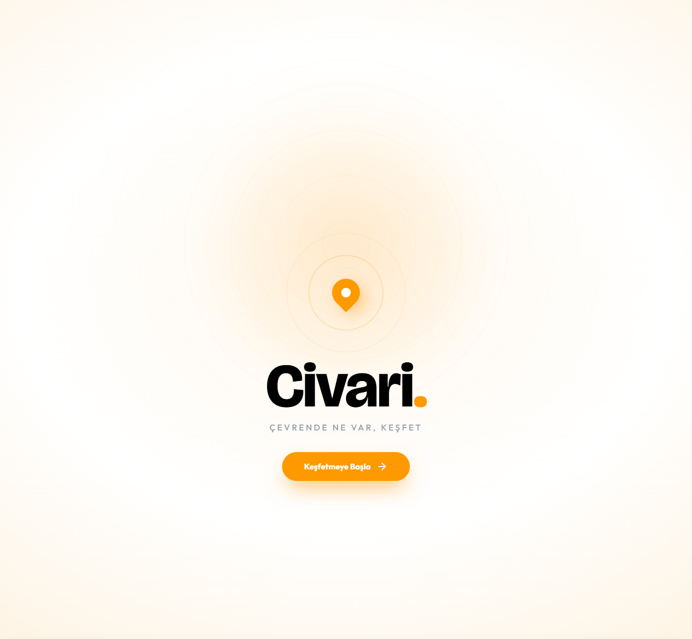
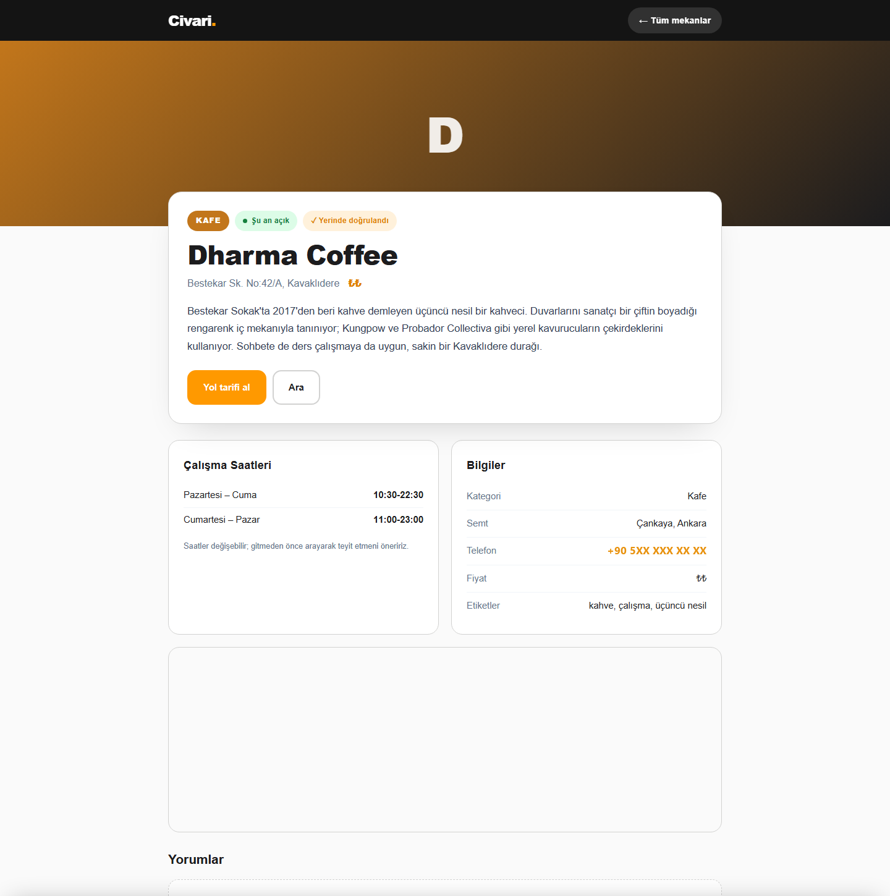

<h1 align="center">Civari</h1>

<p align="center">
  <b>Çevrende ne var, keşfet.</b><br/>
  Ankara merkezli, yerinde doğrulanmış mekân keşif platformu — canlı yayında.
</p>

<p align="center">
  <a href="https://civari.com.tr"></a>
  
  
  
  
</p>

---

## Ürün

Civari, kullanıcının bulunduğu yerin çevresindeki kafe, restoran, bar ve tatlıcıları haritada gösteren; check-in, değerlendirme ve favori özellikleriyle bir keşif alışkanlığına dönüştüren bir platform. Tasarımından sunucu yönetimine kadar tek başıma geliştirdim ve yayına aldım.

Mekân verisi elle girilmiyor: **OpenStreetMap/Overpass API**'den otomatik çekilip yerel şemaya eşleniyor, sonra "yerinde doğrulandı" işaretiyle elle teyit ediliyor.

<p align="center">
  
  
</p>

## Özellikler

| Alan | Detay |
|---|---|
| **Harita keşfi** | Leaflet haritası; mekânlar görünen alana (viewport) göre yükleniyor |
| **OSM içe aktarma** | `import_osm.php` Overpass API'den çeker, etiketleri yerel şemaya eşler |
| **Check-in & liderlik** | Kullanıcı mekânda check-in yapar, puan kazanır, liderlik tablosuna girer |
| **Değerlendirme & favori** | Mekân bazlı puan, yorum ve kişisel favori listesi |
| **İşletme paneli** | İşletme sahibi mekânını sahiplenir (`isletme.php`), bilgi ve galerisini yönetir |
| **Yönetim paneli** | Mekân, yorum ve sahiplik taleplerinin moderasyonu |
| **Kurulabilir PWA** | Web app manifest + service worker; ana ekrana kurulur |
| **Mobil kabuk** | `mobile/` altında Capacitor sarmalayıcı (Android/iOS paketleme) |
| **Yasal** | KVKK, gizlilik, çerez ve kullanım koşulları sayfaları + onay akışı |

## Mimari

```
index.html + script.js       Harita arayüzü, viewport bazlı yükleme
get_venues.php               Sınırlayıcı kutu (bbox) sorgusu → JSON
db.php                       PDO bağlantısı; 127.0.0.1 ve localhost'u sırayla dener
auth.php                     Kayıt / giriş, parola hash'leme, oran sınırlama
checkin.php                  Check-in + puanlama
reviews.php · favorites.php  Kullanıcı-mekân etkileşimleri
mekan.php                    Mekân detay sayfası (SSR)
isletme*.php                 İşletme sahibi sahiplenme ve yönetimi
import_osm.php               Overpass API → yerel şema
sql/                         Şema migrasyonları (veri içermez)
mobile/                      Capacitor yerel kabuk
sw.js · manifest.json        PWA çevrimdışı kabuğu
```

### Kayda değer tasarım kararları

**Mekânlar hepsi birden değil, harita görünümüne göre çekiliyor.** İstemci sınırlayıcı kutusunu gönderir, `get_venues.php` yalnızca o alana düşenleri döner. Veri kümesi büyüdükçe yanıt boyutu sabit kalır.

**Tohum veri kaynağı OpenStreetMap.** Binlerce mekânı elle girmek yerine `import_osm.php` Overpass'a sorgu atıp OSM etiketlerini yerel şemaya eşler — veritabanı herhangi bir şehir için kendini besleyebilir. Doğruluk için üzerine elle "yerinde doğrulandı" katmanı bindirilir.

**Bağlantı katmanı iki host dener.** Paylaşımlı hostingler MySQL soketine `localhost` mu `127.0.0.1` mi çözümlediği konusunda tutarsız; `db.php` hata vermeden önce ikisini de dener.

**Servis çalışanı yalnızca kabuğu önbelleğe alır, veriyi değil.** Zayıf bağlantıda uygulama açılır, ancak mekân listesi her zaman tazedir.

## Yerel kurulum

**Gereksinimler:** PHP 8+, MySQL 8+

```bash
git clone https://github.com/canogluy06-byte/civari.git
cd civari
mysql -u root -p < sql/01_schema_osm.sql
```

Kalan migrasyonları `sql/` içindeki sıra numarasına göre uygulayın, `db.php` içindeki kimlik bilgilerini kendinizinkiyle değiştirin ve çalıştırın:

```bash
php -S localhost:8000
```

Mekânları OpenStreetMap'ten doldurmak için:

```bash
php import_osm.php
```

## Bu depo hakkında

Canlı ürünün **portfolyo sürümüdür**. Veritabanı kimlik bilgileri, gerçek işletme kayıtları içeren tohum verisi, yüklenen görseller ve sunucu adresleri kaldırılmıştır; şema ve uygulama kodu olduğu gibidir. Yapılandırma değerleri `CHANGE_ME` yer tutucusudur — çalıştırmadan önce kendi değerlerinizi girin.

Ekran görüntüleri canlı siteden alınmıştır; işletme telefonu maskelenmiştir.
